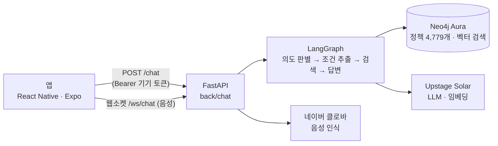

# 복지 상담 챗봇 (Team SOLV)

어르신도 쉽게 쓰는 AI 복지 정책 상담 앱입니다. 상황을 말하면 받을 수 있는 복지 혜택을 **정책 카드**로 보여주고,
카드를 누르면 지원 대상·내용·신청 방법과 복지로 링크를 볼 수 있습니다. 음성으로도 질문할 수 있습니다.

## 주요 기능

- **카드형 답변**: 정책 내용은 DB 원문 그대로 카드로 보여주고, AI는 짧은 소개·카드 선택·카드별 요점(무엇을/누가)만 만든다 → 긴 글과 환각을 줄임
- **맞춤 검색**: 폰에 저장한 나이·지역·가구 상황을 질문과 함께 보내 지역 필터·대상 조건을 자동으로 보충
- **대화 속 정보 감지**: "기초수급자인데…"처럼 말하면 "내 정보에 저장할까요?"로 물어봄 (AI가 붙인 조건은 사용자 문장에 근거가 있을 때만 사용)
- **음성 질문**: 네이버 클로바 실시간 음성 인식(웹소켓 → gRPC), 다 말하면 바로 전송
- **여러 상담방**, 카드 보관·숨기기, 공유
- **접근성**: 글자 크기 12~28, 색약 모드(Okabe-Ito 팔레트), 버튼 최소 높이 44, 움직임 줄이기 존중
- **개인정보 보호**: 내 정보는 폰 암호화 저장소에만, 기기 토큰 인증으로 남의 대화 기록 접근 차단, 서버 로그엔 글자 수만

## 구조



## 기술 스택

| 구분 | 사용 기술 |
|---|---|
| 앱 | React Native 0.86, Expo SDK 57, TypeScript, Expo Router, React Context, axios, Reanimated, expo-secure-store, expo-blur |
| 서버 | Python 3.11, FastAPI, LangGraph, LangChain, Pydantic |
| AI·검색 | Upstage Solar(solar-pro, solar-mini, 임베딩), Neo4j(그래프 + 벡터 인덱스) |
| 음성 | 네이버 클로바 Speech(gRPC), 웹소켓, 16kHz PCM 스트리밍 |
| 데이터 | 공공데이터포털 복지 서비스 API, 복지로 상세 정보 크롤링 |
| 배포 | Render(서버), EAS Build(안드로이드) |

## 폴더

```
front/welfare-chat-app/   앱 (자세한 구조는 그 폴더 README)
back/chat/                서비스 백엔드 (FastAPI + LangGraph)
back/data_ext/            데이터 수집·가공·Neo4j 적재
back/rag/, back/GraphRAG/ 검색 방식 실험 (기준선 RAG / GraphRAG)
back/chat 3turn/          이전 버전 백엔드
```

## 실행

### 서버 (back/chat)

```bash
cd back/chat
python -m venv .venv
.venv/Scripts/pip install -r requirements.txt     # macOS·Linux: .venv/bin/pip
.venv/Scripts/python -m uvicorn main:server --host 127.0.0.1 --port 8000
```

`back/chat/.env`에 필요한 값 (저장소에는 올리지 않음):

| 이름 | 용도 |
|---|---|
| `UPSTAGE_API_KEY` | LLM·임베딩 |
| `NEO4J_URI`, `NEO4J_USERNAME`, `NEO4J_PASSWORD`, `NEO4J_DATABASE` | 정책 DB |
| `CLOVA_SECRET` | 음성 인식 |
| `DEVICE_TOKEN_SECRET` | 기기 토큰 서명 키 (긴 무작위 문자열, 없으면 재시작마다 토큰 무효) |
| `OPENAI_API_KEY` | `/File`(파일 음성 인식)용. 안 쓰면 아무 값(`sk-dummy`)이라도 있어야 서버가 뜸 |

### Render 배포

Web Service로 이 저장소를 연결하고 아래처럼 설정합니다. 환경변수는 위 표 + `PYTHON_VERSION=3.11.9`.

| 항목 | 값 |
|---|---|
| Root Directory | `back/chat` |
| Build Command | `pip install -r requirements.txt` |
| Start Command | `uvicorn main:server --host 0.0.0.0 --port $PORT` |
| Health Check Path | `/Health` |

### 앱

음성 인식이 네이티브 모듈이라 Expo Go가 아닌 **개발용 빌드**로 실행합니다.

```bash
cd front/welfare-chat-app
npm install
npx eas-cli build -p android --profile development   # 처음 한 번, 또는 네이티브 패키지를 바꿨을 때
EXPO_PUBLIC_API_URL=https://<서버 주소> npx expo start --dev-client
```

서버 주소를 안 주면 `constants/config.ts`의 기본 Render 주소를 씁니다.

## API

| 요청 | 설명 |
|---|---|
| `POST /auth/device` | 기기 토큰 발급 → `{device_token}` |
| `POST /chat` | `{session_id, user_message, profile?}` → `{bot_reply, reply_type, cards[], detected[]}` |
| `GET /chat/history/{session_id}` | 이 기기의 지난 대화 |
| `WS /ws/chat/{session_id}?token=` | 음성 스트리밍, 인식 결과를 실시간으로 받음 (`final: true`면 끝) |
| `GET /Health` | 서버 상태 |

`/Health` 외에는 모두 `Authorization: Bearer <기기 토큰>`이 필요합니다.

## 알려진 한계

- 대화 기록은 서버 메모리(`MemorySaver`)에 있어서 서버가 재시작하면 사라짐 → 배포 전 DB 저장 필요
- 지자체 정책(약 90%)은 DB에 한 문장 요약만 있어 카드 내용이 짧음
- "~도 알려줘"처럼 이어서 물으면 이전 주제가 검색어에 섞이는 문제 (개선 예정)
